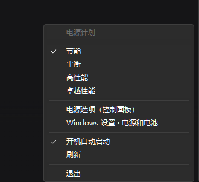

# PowerPlanTray · Windows 任务栏电源计划快速切换

给 **台式机** 装上笔记本才有的"电池面板"体验：任务栏托盘一个电池图标，点开就是原生菜单，点一下立刻切电源计划。



托盘里的样子（放大）：绿色 = 节能，蓝色 = 平衡，橙色 = 高性能，红色 = 卓越性能。


---

## 为什么写这个东西

Windows 11 只有在**检测到电池**时才在任务栏托盘显示电源图标。台式机上想换电源计划，只能：

- `控制面板 → 电源选项 → 选择计划`（4~6 次点击）
- 或者按教程给桌面右键菜单加一个「电源选项」——点开还是控制面板窗口，不能一键切换

这个工具把这件事压到 **两次点击**：点图标 → 点计划。

## 功能

| 功能 | 说明 |
| --- | --- |
| 托盘电池图标 | 颜色随当前计划变化，鼠标悬停显示「电源计划：xxx」 |
| 原生菜单 | 左键/右键单击图标弹出，Win32 `TrackPopupMenu`，**跟随系统深浅色主题** |
| 秒切 | 直接调 `powrprof!PowerSetActiveScheme`，不启子进程、不闪黑框 |
| 开机自启 | 菜单里勾选/取消，写入当前用户「启动」文件夹 |
| 外部同步 | 在控制面板里改了计划，2 秒内图标自动跟随 |
| 命令行 | `PowerPlanTray.exe --set 高性能`，方便绑快捷键/计划任务 |
| 单文件 | `PowerPlanTray.exe` 约 19 KB，纯 .NET Framework 4.x，零第三方依赖 |

菜单项：当前计划列表（打勾的是生效中）、电源选项（控制面板）、Windows 设置 · 电源和电池、开机自动启动、刷新、退出。

## 使用

1. 下载 [Release](https://github.com/SCIENII/power-plan-tray/releases) 里的 `PowerPlanTray.exe`，放到一个固定目录（例如 `%LOCALAPPDATA%\PowerPlanTray\`）
2. 双击运行，托盘出现电池图标
3. 单击图标 → 点要用的电源计划
4. 需要开机自动启动：菜单里点一下「开机自动启动」

> 如果图标被折叠进 `^` 溢出区：Win11 里把它拖到托盘可见区，或 `设置 → 个性化 → 任务栏 → 其他系统托盘图标` 里打开。本仓库的脚本会在首次运行时按 exe 路径自动写入
> `HKCU\Control Panel\NotifyIconSettings\<hash>\IsPromoted = 1`（见下文踩坑 #5）。

## 构建

需要 .NET Framework 4.x 自带的 `csc.exe`（Win10/11 已内置，无需安装 SDK）：

```bat
build.cmd
```

等价命令：

```bat
"%WINDIR%\Microsoft.NET\Framework64\v4.0.30319\csc.exe" /nologo /target:winexe /codepage:65001 ^
  /optimize+ /out:PowerPlanTray.exe ^
  /r:System.dll /r:System.Drawing.dll /r:System.Windows.Forms.dll src\PowerPlanTray.cs
```

`/target:winexe` 保证双击运行不弹控制台；`/codepage:65001` 是中文源码不乱码的关键（见踩坑 #8）。

## 实现要点

- **读计划**：枚举注册表 `HKLM\SYSTEM\CurrentControlSet\Control\Power\User\PowerSchemes`，用 `PowerReadFriendlyName` 取本地化名称（不解析 `powercfg /list` 的输出，避免语言/编码问题）；按注册表里的英文回退名给计划排序和配色。
- **切计划**：`PowerSetActiveScheme(NULL, &guid)`，比 `powercfg /s` 快且无窗口闪烁。
- **菜单**：`CreatePopupMenu` + `AppendMenuW` + `TrackPopupMenu(TPM_RETURNCMD | TPM_WORKAREA)`，由系统绘制，自动获得 Win11 深色主题、圆角与键盘导航。
- **图标**：GDI+ 画电池（电量条 = 计划档位，颜色 = 计划类别），以 **PNG 负载写 ICO**，一次给 16/20/24/32 四个尺寸（母版 128px 缩放），保证托盘里不糊。

## 踩坑记录

> 这部分是本次开发真正花时间的地方，按"现象 → 原因 → 解法"记录。

### 1. 台式机根本没有电源图标

`NotifyIcon` 只有在系统有电池时才由 Shell 提供。台式机必须自己画一个托盘图标——所以电池形状是手绘的，不是系统图标。

### 2. 用 WinForms `ContextMenuStrip` 弹菜单，菜单会"粘"在屏幕上

现象：从 `NotifyIcon.MouseClick` 里 `menu.Show(Cursor.Position)`，菜单能弹出、能点选，但**点别处不消失、ESC 也关不掉**，只能点其中一项让它自己收起来。

原因：菜单窗口没有拿到前台焦点，也就没有鼠标捕获，外部点击根本送不到菜单窗口。

### 3. 换成原生 `TrackPopupMenu` 依旧粘住 —— 真正的原因是前台锁

现象：改用 `TrackPopupMenu` 后问题一模一样。排查 `GetForegroundWindow()` 发现前台窗口仍是别的程序，菜单窗口从未成为前台。

原因：Windows 的**前台锁**（foreground lock）会静默拒绝后台进程的 `SetForegroundWindow`，从托盘图标点开的菜单尤其容易中招。

解法：

```csharp
AttachThreadInput(fgThread, GetCurrentThreadId(), true);  // 临时共享输入队列
BringWindowToTop(hwnd);
SetForegroundWindow(hwnd);
AttachThreadInput(fgThread, GetCurrentThreadId(), false);
```

并在 `TrackPopupMenu` 返回后补一个 `PostMessage(hwnd, WM_NULL, 0, 0)`（MSDN 的标准做法），否则菜单可能残留一小会儿。修完 `EnumWindows` 里 `#32768` 菜单窗口的出现/消失与点击完全同步。

### 4. 菜单压住了任务栏

现象：菜单底部最后一项「退出」被任务栏盖掉一截。

原因：`TrackPopupMenu` 默认按**屏幕**区域定位，不理会任务栏占掉的**工作区**。

解法：加 `TPM_WORKAREA` 标志（`0x10000`），菜单会自动上翻/避让。

### 5. 新托盘图标默认藏在 `^` 溢出区里

现象：程序跑起来了，托盘看不到图标。

原因：Win11 把新出现的托盘图标默认放进溢出区。

解法：写注册表并重启 explorer：

```powershell
# 键名是 exe 路径的哈希，只能运行时按 ExecutablePath 找
$key = Get-ChildItem 'HKCU:\Control Panel\NotifyIconSettings' |
  Where-Object { (Get-ItemProperty $_.PSPath).ExecutablePath -like '*PowerPlanTray.exe' }
Set-ItemProperty -Path $key.PSPath -Name IsPromoted -Value 1 -Type DWord
Stop-Process -Name explorer -Force; Start-Process explorer
```

### 6. 自绘图标透明背景变成黑块

现象：`Icon.FromHandle(bitmap.GetHicon())` 之后，托盘图标四角是黑的。

原因：`GetHicon` 走的是老式 AND 掩码路径，32 位 PNG 的 alpha 通道丢失。

解法：手动拼一个 ICO 容器，每个尺寸直接塞 **PNG 载荷**（Vista 起的 ICO 支持 PNG 压缩条目），alpha 完整保留：

```
ICONDIR(6B) + ICONDIRENTRY(16B/尺寸) + PNG 数据
```

16px 清晰的关键不是硬画 16px，而是 **128px 母版 + HighQualityBicubic 缩放**（一次输出 16/20/24/32 四档）。

### 7. 注册表里的 `PowerSchemes` 混着"电源模式"覆盖层

`HKLM\...\Power\User\PowerSchemes` 下除了真计划，还有 Win11「电源模式」的三个 overlay：

- `ded574b5-45a0-4f42-8737-46345c09c238`（最佳性能）
- `961cc777-2547-4f9d-8174-7d86181b8a7a`（最佳能效）
- `3af9b8d9-7c97-431d-ad78-34a8bfea439f`（高性能覆盖层）

它们出现在注册表里、`powercfg /list` 里却没有，直接列出来会让用户点到无效项（`PowerSetActiveScheme` 返回失败）。必须按 GUID 过滤。

### 8. `csc` 编译中文源码变乱码

现象：菜单文字全是 `锟斤拷`。

原因：`csc` 无 BOM 时按系统 ANSI 代码页（这里是 936）读源码，UTF-8 字节被误解释。

解法：`/codepage:65001`。

### 9. `winexe` 没有控制台，命令行输出全丢

现象：`PowerPlanTray.exe --list` 在 PowerShell 里 `$out` 是空的，`$LASTEXITCODE` 也不是程序的返回值。

原因：GUI 子系统进程不挂控制台，`Console.WriteLine` 无处可去；PowerShell 也不等待 GUI 进程。

解法：命令行模式只用**返回码**表达结果（`0` 成功），或者用 `Start-Process -Wait -PassThru` 读 `ExitCode`。

### 10. 其它小坑

- `using System.Threading;` + `using System.Windows.Forms;` 时 `Timer` 二义性（`CS0104`），显式写 `System.Windows.Forms.Timer`。
- 菜单里的"开机自动启动"勾选状态每次打开菜单都要重新读文件系统，否则取消勾选后不会刷新。
- 切换计划后图标要立刻更新，同时保留 2 秒轮询兜底——否则用户在控制面板改完，托盘图标会一直是旧的。
- Explorer 崩溃重启后 WinForms `NotifyIcon` 会自己重新注册（`TaskbarCreated` 消息），不用额外处理；但注册表里的 `IsPromoted` 不会丢。

## 已知限制

- 只在 Windows 11 23H2（22631）/ 台式机上实测；Win10 理论上可用（深色菜单在 Win10 1903+ 也支持）。
- 「卓越性能」计划只有部分系统预置，没有就不会出现在菜单里。
- 深色菜单依赖 `uxtheme.dll` 未公开导出（`#135 SetPreferredAppMode`、`#133 AllowDarkModeForWindow`、`#136 FlushMenuThemes`），失败时自动退回浅色，不影响功能。

## 许可

[MIT](LICENSE)
